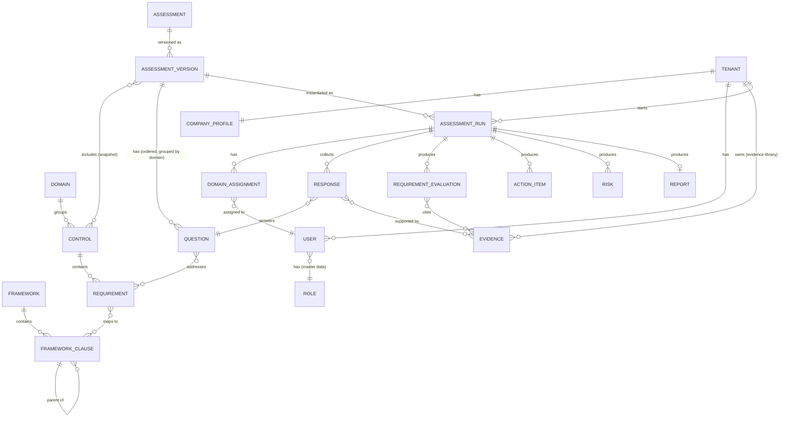

# Project Idea: TrustUp, an AI-Powered GRC Platform

> Product name: **TrustUp**
> **Current scope: Proof of Concept (POC)**

An AI-powered, multi-tenant **Governance, Risk & Compliance (GRC)** platform that lets companies complete compliance and security assessments through an interactive, AI-guided experience — turning a traditionally painful, form-heavy process into a guided conversation that produces verified results, action items, risks, and a report.

---

## 1. Vision & Principles

- **Minimal friction.** Users should never feel like they are filling out a 300-row spreadsheet. The AI guides them through the process step by step.
- **Simple UX everywhere.** Every screen, for both the platform admin and tenants, should be as simple as possible. If a step can be automated or inferred, it should be.
- **AI suggests, humans verify.** The AI drafts, infers, and recommends; a human confirms. Every AI-produced conclusion is traceable and requires human verification before it is final.
- **Immutable history.** Anything that is published or used in an assessment is snapshotted and versioned, so changes never silently alter work in progress or past results.
- **Efficient AI processing.** Never process the same content twice. Evidence and documents are analyzed once and the results reused.

---

## 2. Actors

| Actor | Scope | Responsibilities |
|---|---|---|
| **Super Admin** (CISS admin) | Platform-wide (single account) | Manages frameworks, domains, controls, requirements, and master data. Creates, versions, and publishes assessments. |
| **Tenant Admin** | One tenant (company) | Signs up the company (self-service), manages tenant users and roles, starts assessments, assigns domains, gives final approval on runs, oversees action items and risks. |
| **Tenant User** | One tenant, role-based | Completes assigned domains (or a whole assessment), answers questions, uploads evidence, verifies AI suggestions on their answers, works on action items. |

- The platform is **multi-tenant**: each company's data (users, assessments, answers, evidence, risks, action items) is isolated in **its own database** (decision 42).
- **Tenant roles** come from a **predefined master data list** and are assigned to users.
- **Domain assignment has no role constraints** for now. Any user with any role can be assigned a domain.

---

## 3. Core Concepts (Glossary)

| Term | Definition |
|---|---|
| **Framework** | An external standard or regulation (e.g. SOC 2, ISO 27001, HIPAA, GDPR, NIST CSF). Imported from a source document and stored in a structured form. |
| **Framework Clause** | A chapter, section, or clause of a framework (e.g. ISO 27001 *A.5.15*, SOC 2 *CC6.1*). Structured hierarchically as parsed from the source document. |
| **Domain** | A logical grouping of controls (e.g. Access Control, Incident Response, Asset Management). Assessments are organized by domain. |
| **Control** | A security/compliance practice an organization should have in place (e.g. "User access is reviewed periodically"). Belongs to a domain. |
| **Requirement** | A granular, testable statement within a control (e.g. "Access reviews occur at least quarterly"). **Requirements are the unit of evaluation** and the place where **one or more framework clauses are mapped**. |
| **Assessment (template)** | Created by the Super Admin: a title, description, and a selected set of controls, with AI-generated questions grouped by domain. Published as an immutable snapshot. |
| **Assessment Run** | A tenant's instance of a published assessment, pinned to the snapshot version it was started from. |
| **Question** | Generated by AI for an assessment, grouped under a domain, **explicitly tagged with the requirements it addresses**. Used to gather information. |
| **Follow-up Question** | An additional question the AI asks during a run when an answer or evidence is insufficient. |
| **Response** | A tenant user's answer to a question. Can include *Not Applicable* with a justification. |
| **Evidence** | Files, documents, screenshots, or links supporting a response. Stored in a tenant's evidence library and analyzed once. |
| **Evidence Library** | A tenant-scoped store of all evidence uploaded. **POC:** reuse within a single run only. Cross-run reuse is deferred. |
| **Maturity Level** | The score given to a requirement in a run (N/A or 0–4, see §7), based on answers and evidence. The basis for rolling up results. |
| **Pre-Assessment Intake** | A short AI-led context gathering step before a run starts (e.g. scope, systems, practices), used to tailor that run's questions. |
| **Requirement Evaluation** | A requirement's result within a run: maturity level, applicability, AI rationale, cited evidence, and verification status. |
| **Coverage** | (a) *Question coverage*: whether every requirement in an assessment is addressed by at least one question. (b) *Framework coverage*: how much of a framework's clauses a run covers and satisfies. |
| **Company Profile** | Basic company information collected at tenant signup (e.g. industry, number of employees). Reused as context for every run. |
| **Action Item** | A remediation task suggested by AI on completion, managed by the tenant. |
| **Risk** | A risk identified by AI from the assessment results, managed by the tenant in a risk register. |
| **Report** | An AI-generated summary of the completed assessment, available in-app and as PDF/DOCX. |
| **Master Data** | Reference data used across modules (e.g. tenant roles, maturity levels, risk categories, likelihood/impact scales, statuses). |

> **Key distinction:** *Questions* are how information is gathered; *Requirements* are what gets evaluated and scored. *Framework clauses* attach to requirements, so one assessment can demonstrate coverage across multiple frameworks.

---

## 4. Domain Model



### Hierarchy at a glance

```
Library (Super Admin, versioned)
  Framework ── Framework Clauses (hierarchical)
                        ▲
                        │ mapped to (many-to-many)
  Domain ── Control ── Requirement

Assessment (Super Admin)
  Title + Description
  Selected Controls → auto-grouped by Domain
  AI-generated Questions per Domain (ordered, tagged to Requirements)
  Published Version = immutable snapshot

Tenant
  Company Profile (from signup)
  Users + Roles (master data)
  Evidence Library (analyzed once, reused)

Assessment Run (Tenant)
  Pinned to a published version
  Domain assignments → users
  Responses + Evidence → AI analysis → Requirement Evaluations
      (maturity level; AI suggested → verified by answerer)
  All domains complete → AI generates Action Items, Risks, Report
  Final review & approval by run starter or Tenant Admin
```

---

## 5. Modules

### 5.1 Tenant Onboarding
- **Self-service signup.**
- Collect only **basic company information** (the Company Profile), e.g. **industry** and **number of employees**. Signup stays short.
- The company is **found in the Swiss commercial register** and its details are proposed from there; the industry (a NOGA 2025 code) is suggested by AI. The user can change everything and is the one who saves it. A company that isn't listed is entered by hand, with the same fields (decision 47).
- A **company profile page** shows the details to every member; a workspace admin can edit them.
- **Before the first assessment** a workspace admin confirms once that the company details are right and complete (decision 48).
- Assessment-specific context is gathered later, in the **Pre-Assessment Intake** (see 5.7), when it is actually needed.

### 5.2 Framework Management (Super Admin)
- Upload a framework source document (PDF/DOCX, etc.).
- **AI parses the document** into a structured hierarchy of chapters/sections/clauses.
- Super Admin reviews, edits, and confirms the parsed structure before it is saved.
- Frameworks are versioned (e.g. ISO 27001:2013 vs. 2022).

### 5.3 Control Library (Super Admin only)
- Manage **Domains**, **Controls**, and **Requirements**.
- Map each requirement to one or more framework clauses across one or more frameworks.
- *(Potential AI assist: suggest clause mappings for a requirement. Human confirms.)*
- All entities are versioned.
- **Tenants cannot manage controls or requirements.** Tenant-side applicability is expressed only through answers (see 5.7).

### 5.4 Master Data (Super Admin)
- Shared reference data used across modules: **tenant roles**, **maturity levels**, risk categories, likelihood/impact scales, evaluation statuses, action item priorities, etc.

### 5.5 Assessment Builder (Super Admin)
Designed to be as simple as possible:
1. Enter **title** and **description**.
2. **Select controls** to include.
3. The system **auto-groups the selected controls by domain**.
4. Domains + controls + requirements are sent to the AI, which **writes one opening question per domain**, tagged to every requirement in that domain (see decision 23). The Super Admin can still edit it or add questions.
5. Super Admin reviews the questions and can **reorder** them. Editing, adding, and deleting questions affects coverage (see §6).
6. **Publish** → creates an immutable versioned snapshot of the assessment, including the exact versions of controls, requirements, clause mappings, and questions.

### 5.6 Assessment Catalog (Tenant)
- **All published assessments are visible to all tenants** (for now).
- Tenants choose which assessment to start.

### 5.7 AI-Guided Assessment Run (Tenant)

**Pre-Assessment Intake**
- Before the run starts, the AI asks a few **intake questions that it generates from the controls in scope** for this assessment (e.g. which systems are in scope, hosting model, existing practices). The Company Profile is used as additional context.
- The AI uses the answers to **tailor the run's questions**, limited to:
  - **Wording** (e.g. using the company's terminology and examples)
  - **Order**
  - **Proposing N/A** for questions/requirements that likely don't apply
- The intake **cannot add or remove questions.** Extra questions only appear as follow-ups during the run.
- Tailoring **never silently removes requirements.** Proposed N/A comes with a reason and the user confirms. This keeps coverage intact.

**Guided Q&A**
The core experience:
- The AI **guides the user through questions** domain by domain in an interactive, conversational flow.
- The AI **helps users answer** (explaining what a question means, what good evidence looks like, etc.), using the Company Profile for context.
- Users submit **answers and evidence**. Evidence can be uploaded or picked from evidence already uploaded in the same run.
- Users can answer **Not Applicable** (a reason is required) as part of answering a question. This is the only way tenants express applicability.
- The AI **analyzes answers and evidence** and assigns **maturity levels** to requirements.
- **Evidence reuse on the go:** when evidence is provided, the AI checks whether it also satisfies **other requirements** in the run and completes them for the user (as suggestions to verify).
- When answers or evidence are insufficient, the AI **asks follow-up / clarifying questions**.
- **The user who answers verifies** the AI's suggestions for their answers.

**Collaboration**
- The user who started the run or the Tenant Admin can **assign any domain to any user** (no role constraints for now).
- Alternatively, **a single person can complete the entire assessment**.

**Deprecated versions**
- If a newer version of the assessment is published while a run is in progress (or after it is complete), the tenant is **notified that their version is deprecated**.
- They **continue their current run** on the version they started with. **No migration.**
- Their next run of that assessment uses the new version.

### 5.8 Completion, Review & Approval (Tenant)
1. All domains are completed and AI suggestions are verified by the answering users.
2. The AI reviews the entire assessment and produces:
   - **Suggested Action Items** (remediation tasks)
   - **Suggested Risks**
   - **An Assessment Report**
3. **Final review and approval:** the user who started the run, or the Tenant Admin, reviews everything (evaluations, action items, risks, report) and **approves** the run.
4. **Rejection:** the reviewer can reject a domain (or specific items in it) with a comment. The domain goes back for rework, and the **run creator, the Tenant Admin, or the user assigned to that domain** can resolve it. Once resolved, the outputs are regenerated as needed and the run returns for approval.

### 5.9 Action Item Management (Tenant)
- Track action items created from assessments: owner, due date, status, priority, linked requirements/controls.

### 5.10 Risk Management (Tenant)
- A risk register populated from assessments: likelihood, impact, owner, treatment, status, linked requirements/controls.

### 5.11 Reporting & Coverage (Tenant)
- Reports are available **in-app**, and exportable as **PDF** and **DOCX**.
- A **framework coverage view** shows how a run maps to each framework (e.g. "72% of ISO 27001 Annex A covered"), using the requirement ↔ clause mappings.

---

## 6. Question Editing & Coverage

Reordering questions is safe. **Editing, adding, or deleting** questions can change which requirements are covered. Because every question is tagged with the requirements it addresses, the builder can track coverage live.

**Coverage rule (decided):** every requirement of every selected control must be addressed by at least one question. **Publishing is blocked** while any requirement is uncovered.

Handling per action:

| Action | Risk | Possible handling |
|---|---|---|
| **Edit** a question | The new wording may no longer address its tagged requirements, or may address others. | AI re-checks the edited question and proposes updated requirement tags; admin confirms. |
| **Add** a question | Its requirement links are unknown. | AI auto-tags it with requirements; admin can adjust. |
| **Delete** a question | Some requirements may be left uncovered. | Warn which requirements would become uncovered; offer to have the AI regenerate a question for them. |
| **Publish** | There may be uncovered requirements. | **Blocked** while any requirement is uncovered. The builder lists the uncovered requirements and offers to generate questions for them. |

A **coverage indicator** in the builder (e.g. "48/50 requirements covered") would keep this simple for the admin.

---

## 7. Scoring

### 7.1 Maturity Scale

Each requirement in a run receives one of these ratings (stored as master data):

| Rating | Name | In short |
|---|---|---|
| **N/A** | Not applicable | The control doesn't apply to the company. **A reason must be given.** |
| **0** | Non-existent | Nothing is in place. Things happen only when someone happens to act. |
| **1** | Partial / Initial / Ad hoc | Some activities exist, but they're informal and depend on individual people. |
| **2** | Defined / Risk informed | Processes and responsibilities are written down, but not followed the same way everywhere, and there's little monitoring. |
| **3** | Managed / Implemented / Repeatable | Processes are approved and followed across the company, with enough resources, and their performance is monitored. |
| **4** | Optimized / Adaptive | The company keeps measuring and improving its processes and learns from experience. |

### 7.2 Roll-up

- **Decided:** roll-up uses a **fixed, reproducible formula**. The AI **explains** the result; it does not decide the score.
- *N/A* requirements are excluded from all calculations.
- Results are calculated at the **control**, **domain**, and **assessment** level, and feed the framework coverage view.
- Each higher-level result shows how it was derived (which requirements, which ratings).

**Formula (decided):**

| Level | Score |
|---|---|
| Control | Average maturity of its applicable requirements |
| Domain | Average of its controls' scores |
| Assessment | Average of its domains' scores |

Scores are shown to one decimal place (e.g. 2.4 / 4). A **"weakest link" flag** highlights any control containing a requirement rated 0, so a high average can't hide a critical gap.

**Framework coverage** for a framework = share of its clauses (mapped to requirements in the run) whose requirements are rated **≥ target maturity** (decided target: **3 – Managed / Implemented / Repeatable**).

---

## 8. Where AI Is Used

| # | Capability | Who | Human-in-the-loop |
|---|---|---|---|
| 1 | Parse framework documents into structured clauses | Super Admin | Admin reviews/edits parsed structure |
| 2 | Generate ordered assessment questions per domain, tagged to requirements | Super Admin | Admin reviews, reorders, edits before publishing |
| 3 | Re-tag requirements on edited/added questions; flag coverage gaps | Super Admin | Admin confirms |
| 4a | Generate intake questions from controls in scope; tailor question wording/order and propose N/A | Tenant | User confirms any proposed N/A |
| 4 | Guide users through the assessment conversationally and help them answer | Tenant | — |
| 5 | Analyze answers + evidence and assign maturity levels to requirements | Tenant | Answering user verifies |
| 6 | Reuse evidence to complete other requirements on the go | Tenant | Answering user verifies |
| 7 | Ask follow-up questions when information is insufficient | Tenant | — |
| 8 | Explain the formula-based roll-up of control/domain/assessment results | Tenant | Reviewed at final approval |
| 9 | Suggest action items and risks from the completed assessment | Tenant | Reviewed at final approval |
| 10 | Generate the assessment report | Tenant | Reviewed at final approval |
| 11 | Tailor guidance using the Company Profile and intake context | Tenant | — |
| 12 | *(Potential)* Suggest requirement ↔ framework clause mappings | Super Admin | Admin confirms |

**AI output principle:** every AI conclusion should carry a **rationale** and, where applicable, a **citation** to the answer or evidence it was based on, plus a status of *AI suggested* or *Human verified*.

**Efficiency principle:** each piece of evidence is processed **once** (e.g. extracted text and analysis are cached per file). Later checks against other requirements reuse the cached result instead of reprocessing the file.

---

## 9. Versioning & Snapshots

- **Versioned entities:** frameworks, framework clauses, domains, controls, requirements, assessments, and master data where relevant.
- **Publishing an assessment creates an immutable snapshot** of everything involved: the assessment, its controls, requirements, clause mappings, and questions at that point in time.
- **Assessment runs are pinned** to the snapshot version they were started from. Later edits by the Super Admin never alter in-progress or completed runs.
- Updates are made by creating a **new version**, which can then be published for future runs.
- When a new version is published, tenants with runs on older versions are **notified that their version is deprecated**. **No migration**; new runs use the latest version.

---

## 10. Key User Flows

### Tenant Onboarding
```
Self-signup: find the company in the register → confirm industry and size → create the account → Invite users + assign roles
```

### Super Admin: Create & Publish an Assessment
```
Title + Description → Select Controls → Auto-group by Domain
  → AI generates ordered questions per domain (tagged to requirements)
  → Review / reorder / edit (live coverage check)
  → Publish (blocked until 100% requirement coverage) → snapshot v1
```

### Tenant: Complete an Assessment
```
Choose published assessment → Pre-Assessment Intake (AI tailors questions)
  → Start run
  → (optional) Assign domains to users
  → AI-guided Q&A per domain (answers + evidence, N/A with reason where relevant)
      → AI analysis → maturity levels (0–4) → reuse evidence for other requirements in the run
      → follow-ups if needed
      → answering user verifies
  → All domains complete
  → Formula roll-up (AI explains) + AI-generated Action Items, Risks, Report
  → Run starter or Tenant Admin reviews everything
      → Reject → domain back to creator / Tenant Admin / domain assignee → resolve → re-review
      → Approve
  → Ongoing management of Action Items & Risks; reports exported (PDF/DOCX)
```

---

## 11. Decisions Log

| # | Topic | Decision |
|---|---|---|
| 1 | Question review | Default order from AI; Super Admin can reorder, edit, add, delete with live coverage tracking (§6). **Publishing is blocked** until every requirement is covered. |
| 2 | Assessment visibility | All published assessments are visible to all tenants (for now). |
| 3 | Roles | Predefined master data list of roles assigned to users. No role constraints on domain assignment (for now). |
| 4 | Verification & sign-off | The answering user verifies AI suggestions. Final review and approval by the run starter or the Tenant Admin. Rejected domains go back; the run creator, Tenant Admin, or domain assignee resolves them. |
| 5 | Question ↔ requirement link | Yes. Questions are explicitly tagged with the requirements they address. |
| 6 | Version upgrades | No migration. Tenants continue on their version, are notified it is deprecated, and use the new version next time. |
| 7 | Recurring assessments | Should be possible; **deferred** to a later phase. |
| 8 | Evidence reuse | Yes. AI checks on the go whether evidence completes other requirements. **POC: within a single run only**; cross-run library deferred. Evidence is processed only once. |
| 9 | Scoring | Maturity scale N/A + 0–4 (§7.1). Roll-up uses a fixed formula; AI explains it (§7.2). |
| 10 | Tenant customization | None for controls/requirements. Not Applicable is expressed only when answering questions. |
| 11 | Framework coverage view | Yes. Tenants see framework coverage. |
| 12 | Reports | In-app, PDF, and DOCX. |
| 13 | Tenant onboarding | Self-signup collecting basic info (industry, number of employees). Assessment-specific context is gathered by a Pre-Assessment Intake that tailors the questions. |
| 14 | Data security | **Out of scope for the POC.** |
| 15 | Initial POC content | NIST CSF 2.0 + ISO/IEC 27001:2022 Annex A, with a small cross-mapped control library (§12). |
| 16 | Roll-up formula | Averages (requirement → control → domain → assessment) + weakest-link flag for any requirement rated 0. Framework coverage target maturity = 3. |
| 17 | Intake content | AI-generated from the controls in scope (not defined by the Super Admin). |
| 18 | Tailoring limits | Intake may change question wording and order and propose N/A only. It cannot add or remove questions. |
| 19 | Notifications | In-app only for the POC (deprecated versions, domain assignments, rejections). |
| 20 | User invites | Tenant Admin creates users with a temporary password (changed on first login). No email sending in the POC. |
| 21 | Evidence file types | PDF, DOCX, XLSX/CSV, PNG/JPG, plain text. |
| 22 | Language | English only. |
| 23 | Questions per domain | **One opening question per domain**, covering all of its requirements. The AI guide follows up topic by topic during the run until every requirement can be rated (follow-up limit scales with the domain: about two per control). Help text lists one bullet per control. |
| 24 | AI usage limits | Per turn: at most 5 model calls of up to 4,000 output tokens; messages up to 4,000 characters. Per question: after 3 turns without progress, or at the question's turn cap (follow-up limit + 3), a wrap-up turn rates what's left (undescribed = 0, with a note) and moves on; if the AI doesn't comply, the backend closes the question and leaves the rest for manual rating. 5 chat turns are allowed after a domain's questions are done. Off-topic messages get a one-sentence redirect. |
| 25 | Manual rating fallback | A person can rate a requirement directly only when no open question covers it or the run's AI budget is used up, so the panel stays uncluttered in normal use. A domain completes once every requirement has a confirmed rating; any question still open is closed then. |
| 26 | Per-run AI budget | Every AI call is logged (`ai_usage`) with tokens and estimated cost. At `RUN_AI_BUDGET_USD` (default $3) guided chat and evidence processing pause for that run; intake, tailoring and results generation always run. No cost dashboard for now. |
| 27 | Relevance pre-check model | Not adopted. An external classifier (e.g. kev-0.8b) would save ~$0.004 per off-topic message, which decision 24 already bounds, at the cost of a GPU/CPU-heavy service and false rejections of real answers. Revisit with a labelled evaluation set if needed. |
| 28 | Rating requirements directly | People can open any requirement at any time and give an answer, a rating (0–4 / N/A with reason) and evidence. With a rating it is completed by that person ("Rated by …"); with only an answer/evidence it is marked *awaiting AI* and the AI suggests a rating for them to confirm. |
| 29 | Background cross-analysis | Every submitted answer or evidence (from the chat or a single requirement) is analysed in the background against all open requirements across the assessment; supported ones get AI suggestions. Requirements a person has rated or confirmed are never changed. Waits for evidence to be read; counts toward the run's AI budget. |
| 30 | Requirements panel | Collapsed to a slim side rail by default (progress + status dots); expands to compact cards; clicking a requirement opens its detail panel. "Complete domain" lives in the workspace header. |
| 31 | Full control fields | Controls carry the full field set: area, organisational role, company risk exposure (one each), control types, protection domains, security capabilities, protection objectives, use cases (several each), and eight text fields (short description, key requirement, risk exposure, involved parties, triggers, supporting documents, special considerations, subject-specific support). Publishing needs the classification and the key requirement. |
| 32 | Control codes | Domain abbreviation + 2-digit number in the domain + "." + 4-digit version, e.g. IAM02.0001. Codes are assigned automatically; the domain can't change once published. Requirements are IAM02-R01. |
| 33 | Requirement fields | Statement (required), guidance (required, short: how to meet it), evidence lines (optional but expected: what proves it), action item and risk templates (optional; title and description both required), framework clause links, mandatory (yes / no / not set). Code and order are made by the app. 1–10 requirements per control. |
| 34 | Organisational roles | Own table (22 roles from `organisational_roles.json`) with abbreviation, type, reports to and six text fields. Replaces the job_role list; users and controls link to it. |
| 35 | Mandatory has no effect yet | Shown in admin screens and runs and given to the AI as context. Doesn't block N/A or weight the rollup; separating mandatory and optional questions is undecided. |
| 36 | AI uses the control fields | Question writing and intake get each control's key requirement, why it matters, use cases and triggers; the guide and background analysis get the full context and evidence lines; outputs use risk exposure, protection objectives, responsible role and mandatory flags. Guidance is given next to every statement (question writing, guided chat, rating, results). |
| 38 | Results start from templates | For every gap (rating below 3), each of the requirement's action and risk templates becomes an item the AI adapts to the company (origin `template`); if the AI skips one, the template is used as written. Free AI writing only for gaps without a template. Every item stays linked to its requirement. Mandatory gaps get no extra weight. |
| 39 | Requirement cards | In the control editor and read view, requirements are collapsible cards (summary when collapsed; full fields when expanded), like the run workspace's requirement cards. |
| 40 | Control import & export | One Excel workbook (Controls, Requirements, Templates, Lists) for the template, the export and the import; no AI. Preview first, all or nothing: any error blocks the import (with "did you mean" suggestions and a file with problems marked). Changed controls become new drafts; existing drafts need overwrite or skip; removing a requirement needs a tick; files older than the published version are refused; controls not in the file are untouched; unknown master data, roles, domains or clauses are never created. Plan: `CONTROL_IMPORT_PLAN.md`. |
| 41 | Newer control versions in draft assessments | A draft assessment that points to superseded control versions shows "Newer control versions are available" with "Use latest versions": question tags carry over for unchanged requirements, and the AI rewrites the question of domains with new or reworded requirements. |
| 42 | One database per company | Requested by the client. A control database holds the tenant registry, a login directory, the super admin, the library and master data. Each company gets its own Postgres database (same server for now). Starting a run copies the published assessment into the company database. Master data is mirrored to every company database. The `tenant_id` columns are dropped. Plan: `TENANT_DATABASE_PLAN.md`. |
| 43 | Client control workbook (02-11-2026) | The client's 49 controls (228 requirements, 678 framework mappings) are loaded through the normal import. A converter (`python -m app.tools.convert_client_workbook`) turns the client's wide layout into our import file and reports every reference that doesn't match the official clause lists. Six frameworks are seeded in full as references and titles only: NIST CSF 2.0, ISO/IEC 27001:2022 (clauses 4 to 10 and Annex A), ISO/IEC 27005:2022, GDPR, Swiss FADP and DPO. Six domains are added (LCM, AM, HRS, TVM, SML, ASM; abbreviations not yet confirmed by the client), making 25. The mappings were written by an AI and are stored as `ai_suggested`. Not loaded: the per-domain "Domain Question", the "Roles" list, control language, and company risk exposure (blank in the workbook). |
| 44 | Separate AI service | Every model call goes through a third deployable, `ai-service`: stateless, no database, reachable only from the backend and worker with a shared token. It owns the prompts, output schemas, tool definitions, model settings and the provider key. The backend sends structured data (`packages/ai_contracts`), runs the guide's tools itself between model calls, and keeps the AI budget and usage records. |
| 45 | Production hardening | After a technical review with 73 findings: revocable sessions, login and sign-up limits, strict settings in production, request and upload limits, a monthly AI budget per company and a cap on open runs, tighter permissions (tenants can't read the control library; intake, submission and registers check who may act), jobs that can't leave a run stuck, row locks on run state and chat turns, a reverse proxy as the only published service, and automated tests. Record: `PRODUCTION_READINESS.md`. |
| 46 | Deployment shape | `docker-compose.yml` is the production stack (proxy, frontend, backend, worker, AI service, Postgres, Redis, file store); `docker-compose.dev.yml` adds hot reload and published ports; `docker-compose.test.yml` runs the tests against throwaway services. |
| 47 | Company lookup and company profile | Sign-up has three steps: find the company, confirm its details, industry and size, create the account. The company is searched in the Swiss commercial register (Zefix, official API with credentials); the backend reads its entry, adds website and headcount from Wikidata where it has them, and the AI service suggests the industry as NOGA 2025 codes from the register's purpose text. What is found is only a proposal: it is shown to the user, who can change every field, and it is saved when the user saves (creating the workspace, or "Save changes" on the company profile page). A company that isn't listed is entered by hand with one sentence on what it does; the same classification suggests the industry and the same fields can be filled in. The company profile page (`/app/company`) shows every field to all members, lets a workspace admin edit them, and can fill the form from the register again. The industry is stored as a NOGA code (`tenant.profile.noga_code`) and its English title (`tenant.industry`). Register lookups live in the backend (credentials, caching, rate limits); only the classification is in the AI service. Decided 2026-11-23: official register API, NOGA codes, Wikidata included, details presented and saved by the user, a profile page. |
| 48 | Company details confirmed before the first assessment | A workspace admin must confirm once that the company details are right and complete before anyone in the company can start an assessment. Confirming needs: what the company does, an industry from the list, street, postcode, city and country (name and employee range are always required). It is recorded with who and when (`tenant.profile.verified_at`, `verified_by`). Starting an assessment while unconfirmed is refused by the server (409); the catalog shows a dialog that takes an admin to the company profile page and back, and tells a team member that an admin has to do it. Later edits keep the confirmation but can't empty those fields. Sign-up does not count as confirming. Decided 2026-11-23. |
| 49 | Review page for a domain | Each domain has a Review page next to the conversation: the list of its requirements with their status on the left, one requirement in full on the right (what it asks, the rating and its reasons, the answers noted in the conversation, the evidence used). "Confirm and next" accepts the rating and moves to the next one still to check; "Change" opens the same answer and rating panel as the conversation page. The Review button can be opened at any time, also on a completed domain (read only). "Complete domain" is unchanged: it is on both pages and only works once a person has confirmed every rating. Confirming in the side panel, including "Confirm all", stays. No backend change. |
| 37 | Master data screens | Grouped navigation (Control classification, Organisation, Assessment & scoring, Risks & actions, link to Domains); selection is in the URL. |

---

## 12. Initial POC Content

**Frameworks**

| Framework | Why |
|---|---|
| **NIST CSF 2.0** | Freely and publicly available, so it's ideal for testing the **AI framework parser** end to end on the real document. |
| **ISO/IEC 27001:2022 (Annex A)** | The most in-demand security standard. Paired with NIST CSF, it demonstrates **cross-framework mapping and coverage**. |

> ISO standard text is copyrighted. For the POC, store clause **IDs and titles** only, and write requirements in our own words. Full clause text can be added once a licensed copy is available.

**Seed control library (approx.)**: 5 domains, ~15 controls, ~45 requirements, each requirement mapped to NIST CSF and ISO 27001 clauses.

| Domain | Example controls |
|---|---|
| Access Control | User access provisioning, access reviews, privileged access, MFA |
| Asset Management | Asset inventory, acceptable use, information classification |
| Incident Management | Incident response plan, incident reporting, lessons learned |
| Business Continuity | Backups, continuity planning, recovery testing |
| Governance & Policy | Information security policy, roles & responsibilities, security awareness training |

**Demo assessment**: one published "Information Security Baseline" assessment using all seed controls, so the full flow (intake → guided Q&A → evidence → approval → report) can be shown.

---

## 13. Open Questions

_None at the product level. All product questions so far are resolved (see §11). Technical questions (stack, AI provider, schema) are covered in Next Steps._

---

## 14. Out of Scope for the POC

- Data security, encryption, data residency, and AI data-handling policies.
- Recurring assessments and reuse of answers from previous runs.
- Cross-run evidence library (evidence reuse is within a single run only).
- Migrating runs between assessment versions.
- Assessment visibility per tenant/plan.
- Role-based constraints on domain assignment.
- Tenant-managed controls or requirements.

---

## 15. Tech Stack (POC)

| Layer | Choice | Notes |
|---|---|---|
| **Frontend** | Next.js (React + TypeScript), Tailwind, shadcn/ui | Clean, simple UI; streaming chat for the guided run |
| **Backend** | Python + FastAPI | Best ecosystem for document/evidence parsing (PDF, DOCX, images) |
| **Database** | PostgreSQL + pgvector | Relational model for versions/snapshots/mappings; vector search over evidence |
| **AI** | Claude: Sonnet 5.5 (guided conversation), Opus 5.5 (framework parsing, evidence analysis, final report) | Structured outputs for questions, requirement tags, maturity ratings |
| **File storage** | **RustFS** (S3-compatible object storage) | **Decided.** Accessed through the standard S3 API, so the storage layer stays swappable |
| **Multi-tenancy** | Shared DB, `tenant_id` on every tenant-owned table | Simplest isolation for the POC |
| **Auth** | Email/password + JWT | SSO later |
| **Exports** | Server-side PDF and DOCX generation | Report formats per §5.11 |
| **Background jobs** | Redis + Python worker (e.g. arq) | Long AI tasks (framework parsing, evidence analysis, report generation) run off the request path |
| **Containerization** | **Docker + Docker Compose** | **Decided.** Every component runs in a container (§16) |

---

## 16. Containerization

**Requirement:** the entire platform runs in containers. One command (`docker compose up`) brings up a fully working environment.

| Service | Image / Build | Purpose | Persistent volume |
|---|---|---|---|
| `frontend` | Built from `./frontend` (Next.js) | Web UI | — |
| `backend` | Built from `./backend` (FastAPI) | REST/streaming API | — |
| `worker` | Same image as `backend`, different command | Background AI and file-processing jobs | — |
| `postgres` | `pgvector/pgvector` (Postgres + pgvector) | Primary database | `postgres_data` |
| `redis` | `redis` | Job queue and cache | `redis_data` |
| `rustfs` | `rustfs/rustfs` | S3-compatible storage for evidence, framework docs, reports | `rustfs_data` |
| `migrate` | Same image as `backend`, runs once | Applies DB migrations and seeds POC content (§12) and the Super Admin account | — |

**Conventions**
- All configuration comes from environment variables (`.env`, with a committed `.env.example`). No secrets in images.
- Images are pinned to specific versions.
- Services have health checks; `backend` and `worker` start only after `postgres`, `redis`, and `rustfs` are healthy and `migrate` has completed.
- A `docker-compose.override.yml` for development adds hot reload (mounted source) for `frontend`, `backend`, and `worker`.
- Only `frontend` and `backend` are exposed to the host (plus the RustFS console in development).

---

## 17. Next Steps

1. Finalize the domain model and database schema.
2. Confirm the remaining tech stack choices (§15).
3. Define the POC build order (suggested: Control Library → Assessment Builder → AI-Guided Run → Completion & Outputs → Reporting).
4. Design key screens with simplicity as the primary constraint.
