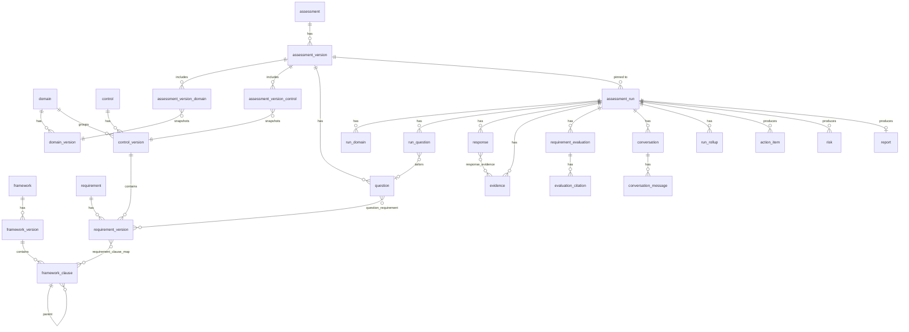

# Database Schema (POC)

Companion to [PROJECT_IDEA.md](PROJECT_IDEA.md). Target: **PostgreSQL 17 + pgvector**.

---

## 1. Conventions

- **Primary keys:** `id uuid` (default `gen_random_uuid()`).
- **Timestamps:** `timestamptz`; every table has `created_at`, most have `updated_at`.
- **Tenant scoping: one database per company** (decision 42, `TENANT_DATABASE_PLAN.md`). No data table has a `tenant_id` column; only `login_directory` names a tenant.
  - The **control database** holds `tenant` (the registry), `login_directory`, the super admin's `app_user` row, the library (frameworks, domains, controls, assessments), master data, control imports, and the platform's own `job`, `ai_usage` and `notification` rows.
  - Each **company database** (`<control db name>_t_<tenant id hex>`) holds that company's `app_user` rows, runs and everything under them (§4.6 to §4.10), and its own `job`, `ai_usage` and `notification` rows.
  - A company database also holds **copies of library rows**: starting a run copies the published assessment version and everything it points to (same ids). `master_data_item` and `organisational_role` are mirrored in full. `control_import` exists there but stays empty.
  - Migrations: `backend/alembic/control` and `backend/alembic/tenant`; `python -m app.tenants migrate` upgrades the control database, then every company database.
- **Enums:** stored as `text` with `CHECK` constraints (easier to evolve than Postgres enums).
- **Naming:** snake_case, singular table names.
- **Deletion:** library content is never hard-deleted once published (retired instead). Drafts may be deleted.

---

## 2. Versioning Model

The core rule: **a published version row is immutable.** Because nothing that has been published can change, *referencing a version row is a snapshot.* No copying is needed.

Each versioned entity is split into two tables:

```
<entity>            stable identity (id, code) — never changes
<entity>_version    content + version number + status
```

**Version lifecycle**

```
draft ──publish──▶ published ──(newer version published)──▶ deprecated
  │
  └── delete (drafts only)
```

| Rule | Enforced by |
|---|---|
| At most **one draft** per entity | Partial unique index `(entity_id) WHERE status = 'draft'` |
| At most **one published** (current) version per entity | Partial unique index `(entity_id) WHERE status = 'published'` |
| Published/deprecated rows are never updated (except `status` → `deprecated`) | Application layer (service methods) |
| Version numbers increase by 1 per entity | `UNIQUE (entity_id, version)` + service layer |
| Editing published content = creating a new draft version (copy of current, then edit) | Service layer |

**What is versioned, and at what granularity**

| Unit of versioning | Includes (immutable with it) |
|---|---|
| `framework_version` | All its `framework_clause` rows |
| `domain_version` | Name, description |
| `control_version` | Title, domain, classification, text fields, all its `requirement_version` rows (evidence, templates, mandatory) and their clause mappings |
| `assessment_version` | Title, description, selected domain/control versions, ordered questions and their requirement tags |

Editing any requirement therefore creates a new **control version**, which keeps a control and its requirements consistent as one unit.

**Snapshot on publish (assessment):** an assessment version stores references to the exact `domain_version` and `control_version` rows it was built from. Since those are immutable, the published assessment can never change underneath a tenant's run.

**Deprecation:** publishing assessment version N+1 sets version N to `deprecated` and creates a notification for every tenant with a run on version N. Runs keep pointing at version N.

---

## 3. Entity Overview



---

## 4. Tables

### 4.1 Identity & Tenancy

```sql
tenant                                 -- control database only: the registry of companies
  id, name,
  industry            text,          -- company profile (signup)
  employee_count      text,          -- range: '1-10','11-50','51-200','201-1000','1000+'
  profile             jsonb default '{}',   -- extra profile fields later
  db_name             text unique not null, -- the company's own database on the same server
  status              text check in ('provisioning','active'),  -- 'provisioning' while signup sets it up
  created_at, updated_at

login_directory                        -- control database only
  email               text primary key,      -- lower case; unique across all companies
  tenant_id           uuid null → tenant,    -- which database the email signs in to; NULL = super admin

app_user                               -- control database: the super admin; company database: its users
  id,
  email               text unique not null,
  password_hash       text not null,
  full_name           text not null,
  platform_role       text not null check in ('super_admin','tenant_admin','tenant_user'),
  organisational_role_id uuid null → organisational_role,
  must_change_password bool default false,   -- temp password from Tenant Admin
  is_active           bool default true,
  last_login_at, created_at, updated_at
```

Two kinds of role:
- **`platform_role`** controls *permissions* (what screens/actions are allowed). Fixed in code.
- **`job_role_id`** is the *predefined master data role* (e.g. CISO, IT Manager, HR Lead) shown on users and used when assigning domains. No permission constraints in the POC.

### 4.2 Master Data

```sql
master_data_item
  id,
  category            text not null,   -- control classification: 'area','control_type','protection_domain',
                                       --   'security_capability','protection_objective','use_case','company_risk_exposure'
                                       -- scoring: 'maturity_level'; registers: 'risk_category','likelihood','impact','action_priority'
  code                text not null,   -- stable, never shown
  label               text not null,   -- the name
  description         text,
  numeric_value       numeric null,    -- e.g. maturity 0–4, likelihood 1–5
  sort_order          int default 0,
  is_active           bool default true,  -- values are switched off, never deleted once used
  created_at, updated_at
  unique (category, code)

organisational_role                    -- who is responsible for a control; also a user's role (replaces job_role)
  id, code unique, name, abbreviation unique ('CISO'),
  type                text check in ('executive','operational'),
  reports_to          text null,       -- plain text: COO and Board of Directors aren't listed roles
  description, purpose, accountabilities, responsibilities, decision_making_powers, interfaces  text null,
  sort_order, is_active, created_at, updated_at
```

Seeded from `backend/app/seed/master_data.py` and `backend/app/seed/organisational_roles.json`. `app_user.organisational_role_id → organisational_role`.

Evaluations, risks, and action items store the **numeric value / code** directly (not only the FK), so later edits to master data labels never change historical results. Controls point at values by id, so renaming a value never changes what a control means.

### 4.3 Frameworks

```sql
framework
  id, code unique ('NIST-CSF','ISO-27001'), name, publisher, created_at

framework_version
  id, framework_id → framework,
  version             int not null,
  version_label       text not null,       -- '2.0', '2022'
  status              text check in ('draft','published','deprecated'),
  source_storage_key  text null,           -- uploaded source doc in RustFS
  parse_status        text check in ('none','pending','processing','done','failed') default 'none',
  parse_error         text null,
  published_at, published_by → app_user, created_at, updated_at
  unique (framework_id, version)

framework_clause
  id, framework_version_id → framework_version,
  parent_id           uuid null → framework_clause,
  ref                 text not null,       -- 'A.5.15', 'PR.AA-01'
  title               text not null,
  description         text null,
  level               int not null,        -- 0 = top (chapter/function)
  sort_order          int not null,
  is_assessable       bool default true,   -- false for pure grouping headings
  unique (framework_version_id, ref)
```

AI parsing writes clauses into a **draft** framework version; the Super Admin reviews and publishes.

### 4.4 Control Library

```sql
domain
  id, abbreviation unique ('IAM'),     -- starts every control code in the domain; never changes
  created_at

domain_version
  id, domain_id → domain, version, status,
  name, description,
  published_at, published_by, created_at, updated_at
  unique (domain_id, version)

control
  id, code unique ('IAM02'),           -- domain abbreviation + 2-digit number in the domain
  created_at                           -- a version is shown as code.version: IAM02.0001

control_version
  id, control_id → control, version, status,
  domain_id           uuid → domain,   -- fixed once a version is published (it's part of the code)
  title,
  area_id                    → master_data_item ('area'), one
  responsible_role_id        → organisational_role, one
  company_risk_exposure_id   → master_data_item ('company_risk_exposure'), may be empty
  short_description, key_requirement, risk_exposure, involved_parties, triggers,
  supporting_documents, special_considerations, subject_specific_support   text null,
  published_at, published_by, created_at, updated_at
  unique (control_id, version)

control_version_classification          -- the several-per-control lists
  control_version_id → control_version, master_data_item_id → master_data_item
  primary key (control_version_id, master_data_item_id)   -- the item's category says which list

requirement
  id, control_id → control, code unique ('IAM02-R01'), created_at   -- stable identity across versions

requirement_version
  id, requirement_id → requirement,
  control_version_id  uuid → control_version,   -- immutable with its control version
  statement           text not null,
  guidance            text not null,            -- short: how to meet it (evidence is what proves it)
  mandatory           bool null,                -- yes / no / not set; shown and given to the AI, no scoring effect yet
  evidence            jsonb default '[]',       -- ["Signed policy", ...]: what can be checked to show it's met
  action_templates    jsonb default '[]',       -- [{title, description}], both required: the measure if it isn't met
  risk_templates      jsonb default '[]',       -- [{title, description}], both required: the risk if it isn't met
  sort_order          int not null
  unique (control_version_id, requirement_id)

requirement_clause_map
  requirement_version_id → requirement_version,
  framework_clause_id    → framework_clause,
  source              text check in ('manual','ai_suggested','ai_confirmed') default 'manual',
  primary key (requirement_version_id, framework_clause_id)

control_import                                  -- one upload of the control workbook (see CONTROL_IMPORT_PLAN.md)
  id, filename, file_key,                       -- the uploaded .xlsx in object storage
  status              text check in ('preview','applied','expired'),
  created_by → app_user, created_at, applied_at,
  summary             jsonb,                    -- counts (+ file sha256, created/updated after apply)
  report              jsonb,                    -- issues (sheet/row/column/message/suggestion) and per-control diffs
  choices             jsonb,                    -- {conflicts: {code: overwrite|skip}, removals: [requirement codes]}
  fingerprints        jsonb                     -- per existing control in the file; apply refuses if any changed

control_version.import_id → control_import null  -- set on drafts an import created (on delete set null)
```

A control has 1 to 10 requirements. Control numbers are handed out under a per-domain advisory lock, so concurrent creations never collide. Action items and risks have origin `ai`, `template` (adapted from a requirement template) or `manual`. Publishing needs an area, an organisational role, at least one value in each several-per-control list, and a key requirement.

**Excel import.** A preview writes nothing to the library. Apply re-runs the preview in one transaction under an advisory lock and refuses (nothing written) if any error appears or any control's fingerprint changed. Imports only create drafts; publishing is separate. Only the newest preview can be applied; previews expire after 24 hours.

### 4.5 Assessments (Super Admin)

```sql
assessment
  id, code unique, created_by → app_user, created_at

assessment_version
  id, assessment_id → assessment, version,
  status              text check in ('draft','published','deprecated'),
  title, description,
  generation_status   text check in ('none','pending','processing','done','failed') default 'none',
  published_at, published_by, created_at, updated_at
  unique (assessment_id, version)

assessment_version_domain                  -- snapshot of domains in this version
  id, assessment_version_id → assessment_version,
  domain_version_id → domain_version,
  sort_order
  unique (assessment_version_id, domain_version_id)

assessment_version_control                 -- snapshot of controls in this version
  assessment_version_id → assessment_version,
  control_version_id    → control_version,
  assessment_version_domain_id → assessment_version_domain,
  sort_order
  primary key (assessment_version_id, control_version_id)

question
  id, assessment_version_id → assessment_version,
  assessment_version_domain_id → assessment_version_domain,
  text                text not null,
  help_text           text null,
  sort_order          int not null,
  origin              text check in ('ai_generated','ai_generated_edited','manual'),
  created_at, updated_at

question_requirement                       -- coverage tags
  question_id → question,
  requirement_version_id → requirement_version,
  source              text check in ('ai','manual'),
  primary key (question_id, requirement_version_id)
```

**Coverage check (publish gate):** every `requirement_version` belonging to the version's `assessment_version_control` rows must appear in `question_requirement` for that version. Publishing is rejected otherwise.

### 4.6 Assessment Runs (Tenant)

These tables, and those in §4.7 to §4.10, exist only in company databases. Their references to library tables point at the company database's own copies.

```sql
assessment_run
  id, assessment_version_id → assessment_version,
  title               text,
  status              text check in ('intake','in_progress','generating_outputs',
                                     'in_review','changes_requested','approved'),
  started_by → app_user, started_at,
  submitted_at, approved_by → app_user, approved_at,
  intake_summary      jsonb null,          -- structured context extracted by AI from intake
  created_at, updated_at

run_domain
  id, run_id → assessment_run,
  assessment_version_domain_id → assessment_version_domain,
  assignee_id         uuid null → app_user,   -- null = whoever is working on the run
  status              text check in ('not_started','in_progress','completed','changes_requested'),
  completed_by, completed_at, created_at, updated_at
  unique (run_id, assessment_version_domain_id)

run_question                               -- per-run tailored questions + follow-ups
  id, run_id → assessment_run,
  run_domain_id → run_domain,
  question_id         uuid null → question,   -- null for follow-ups
  parent_run_question_id uuid null → run_question,  -- set for follow-ups
  kind                text check in ('base','follow_up'),
  text                text not null,          -- tailored wording (or follow-up text)
  sort_order          int not null,
  proposed_na         bool default false,     -- AI suggestion from intake
  proposed_na_reason  text null,
  status              text check in ('pending','answered','skipped_na') default 'pending',
  created_at, updated_at
```

Base `run_question` rows map 1:1 to `question` rows (wording/order may differ); the intake can't add or remove base questions. Follow-ups inherit requirement tags from their parent question.

### 4.7 Responses & Evidence

```sql
response
  id, run_id → assessment_run,
  run_question_id → run_question,
  answer_text         text null,
  is_na               bool default false,
  na_reason           text null,              -- required when is_na
  answered_by → app_user, answered_at, updated_at
  unique (run_question_id)
  check: not is_na or na_reason is not null

evidence
  id, run_id → assessment_run,
  storage_key         text not null,          -- RustFS object key
  filename, content_type, size_bytes,
  sha256              text not null,
  processing_status   text check in ('pending','processing','ready','failed') default 'pending',
  extracted_text      text null,              -- extracted ONCE
  summary             text null,              -- AI summary, extracted ONCE
  processing_error    text null,
  uploaded_by → app_user, created_at, updated_at
  unique (run_id, sha256)                     -- same file in the same run is never processed twice

response_evidence
  response_id → response, evidence_id → evidence,
  primary key (response_id, evidence_id)
```

### 4.8 Evaluations

```sql
requirement_evaluation
  id, run_id → assessment_run,
  requirement_version_id → requirement_version,
  rating              smallint null check (rating between 0 and 4),   -- null when N/A
  is_na               bool default false,
  na_reason           text null,
  rationale           text not null,
  ai_rating           smallint null,          -- AI's original suggestion (kept for audit)
  ai_is_na            bool null,
  status              text check in ('ai_suggested','verified','overridden'),
  verified_by → app_user, verified_at,
  created_at, updated_at
  unique (run_id, requirement_version_id)
  check: is_na = (rating is null)

evaluation_citation
  id, evaluation_id → requirement_evaluation,
  response_id         uuid null → response,
  evidence_id         uuid null → evidence,
  excerpt             text null,              -- quoted passage the AI relied on
  check: response_id is not null or evidence_id is not null
```

`overridden` = the user changed the AI's rating while verifying. The AI's original suggestion stays in `ai_rating`.

### 4.9 Roll-up, Outputs & Review

```sql
run_rollup                                 -- calculated by formula when outputs are generated
  id, run_id → assessment_run,
  level               text check in ('control','domain','assessment','framework'),
  ref_id              uuid not null,          -- control_version / assessment_version_domain /
                                              -- assessment_version / framework_version id
  score               numeric(3,1) null,      -- null if all N/A; for 'framework' = coverage %
  has_weakest_link    bool default false,     -- any applicable requirement rated 0
  explanation         text null,              -- AI explanation of the result
  unique (run_id, level, ref_id)

action_item
  id, run_id uuid null → assessment_run,
  title, description,
  priority            text,                   -- master data code ('action_priority')
  status              text check in ('suggested','open','in_progress','done','dismissed'),
  owner_id → app_user null, due_date date null,
  origin              text check in ('ai','manual'),
  created_by, created_at, updated_at

action_item_requirement
  action_item_id → action_item, requirement_version_id → requirement_version,
  primary key (action_item_id, requirement_version_id)

risk
  id, run_id uuid null → assessment_run,
  title, description,
  category            text,                   -- master data code ('risk_category')
  likelihood          smallint check (likelihood between 1 and 5),
  impact              smallint check (impact between 1 and 5),
  score               smallint generated always as (likelihood * impact) stored,
  treatment           text check in ('mitigate','accept','transfer','avoid') null,
  status              text check in ('suggested','open','mitigating','accepted','closed'),
  owner_id → app_user null,
  origin              text check in ('ai','manual'),
  created_by, created_at, updated_at

risk_requirement
  risk_id → risk, requirement_version_id → requirement_version,
  primary key (risk_id, requirement_version_id)

report
  id, run_id → assessment_run unique,
  content             jsonb not null,         -- structured report (sections), rendered in-app
  status              text check in ('draft','final'),
  pdf_storage_key, docx_storage_key,          -- generated on export
  generated_at, created_at, updated_at

review_comment                             -- rejection feedback during final review
  id, run_id → assessment_run,
  run_domain_id → run_domain,
  target_type         text check in ('domain','evaluation','action_item','risk','report'),
  target_id           uuid null,
  comment             text not null,
  created_by → app_user, created_at,
  resolved_by → app_user null, resolved_at null
```

AI-suggested action items and risks start as `suggested`; the reviewer accepts (→ `open`) or dismisses them during final review.

### 4.10 Conversations (AI-guided flow)

```sql
conversation
  id, run_id → assessment_run,
  kind                text check in ('intake','domain'),
  run_domain_id       uuid null → run_domain,   -- set when kind = 'domain'
  state               jsonb default '{}',        -- current question pointer, pending follow-ups
  created_at, updated_at

conversation_message
  id, conversation_id → conversation,
  role                text check in ('user','assistant','system_event'),
  content             text not null,
  data                jsonb null,               -- structured payload (question shown, suggestions, etc.)
  author_id           uuid null → app_user,
  created_at
```

One conversation per domain means assignees each have their own thread, and a single user simply moves from one domain conversation to the next.

**As implemented:**
- `conversation.state` holds the frozen system prompt and the raw, append-only model transcript (thinking blocks included) for the guide agent, plus small counters (follow-ups per question, evidence awaiting an answer). `conversation_message` holds what the UI shows: user messages, assistant replies, and question / answer-saved / domain-done events.
- The pre-assessment intake is a short form rather than a chat: its AI-generated questions, the answers and the AI's context summary live in `assessment_run.intake_summary`. No `intake` conversation rows are created.
- Migration `b2f1c0d4e5a6` adds `dismissed` to `risk.status` so reviewers can dismiss suggested risks.

### 4.11 Platform

These tables exist in the control database (platform work) and in every company database (that company's work).

```sql
notification
  id, user_id → app_user,
  type                text,   -- 'assessment_deprecated','domain_assigned','changes_requested',
                              -- 'run_submitted','run_approved'
  payload             jsonb,
  read_at null, created_at

job                                        -- background work tracked for the UI
  id,
  type                text,   -- 'parse_framework','generate_questions','process_evidence',
                              -- 'generate_intake','tailor_questions','generate_outputs','export_report'
  status              text check in ('queued','running','done','failed'),
  ref_type, ref_id,           -- what the job is about
  payload jsonb, result jsonb, error text,
  attempts int default 0,
  created_at, started_at, finished_at
```

---

## 5. Key Indexes

- Partial unique indexes for one draft / one published version per entity (§2).
- `framework_clause (framework_version_id, parent_id, sort_order)`
- `question (assessment_version_id, assessment_version_domain_id, sort_order)`
- `run_question (run_id, run_domain_id, sort_order)`
- `requirement_evaluation (run_id, status)`
- `notification (user_id, read_at)`
- `job (status, created_at)`

---

## 6. Calculations

**Control score** = average `rating` of applicable (`is_na = false`) evaluations for its requirement versions in the run.
**Domain score** = average of its controls' scores (controls with all-N/A excluded).
**Assessment score** = average of its domains' scores.
**Weakest link** = any applicable requirement rated 0 in that control/domain/assessment.
**Framework coverage** (per framework version referenced by the run's requirement mappings) =
`count(assessable clauses whose mapped, applicable requirements all have rating ≥ 3)` ÷ `count(assessable clauses mapped to at least one applicable requirement in the run)`.

---

## 7. Not Included Yet

- `pgvector` embedding tables for evidence chunks. The extension is enabled, but the POC uses each evidence file's extracted text and summary directly. Add `evidence_chunk(embedding vector)` when evidence volume requires semantic search. (Claude has no embeddings endpoint; a separate embeddings provider would be needed.)
- Cross-run evidence library (`evidence` is scoped to a run in the POC).
- Recurring runs and answer carry-over.
- Audit log of all changes (beyond the version history and AI-vs-human fields).
